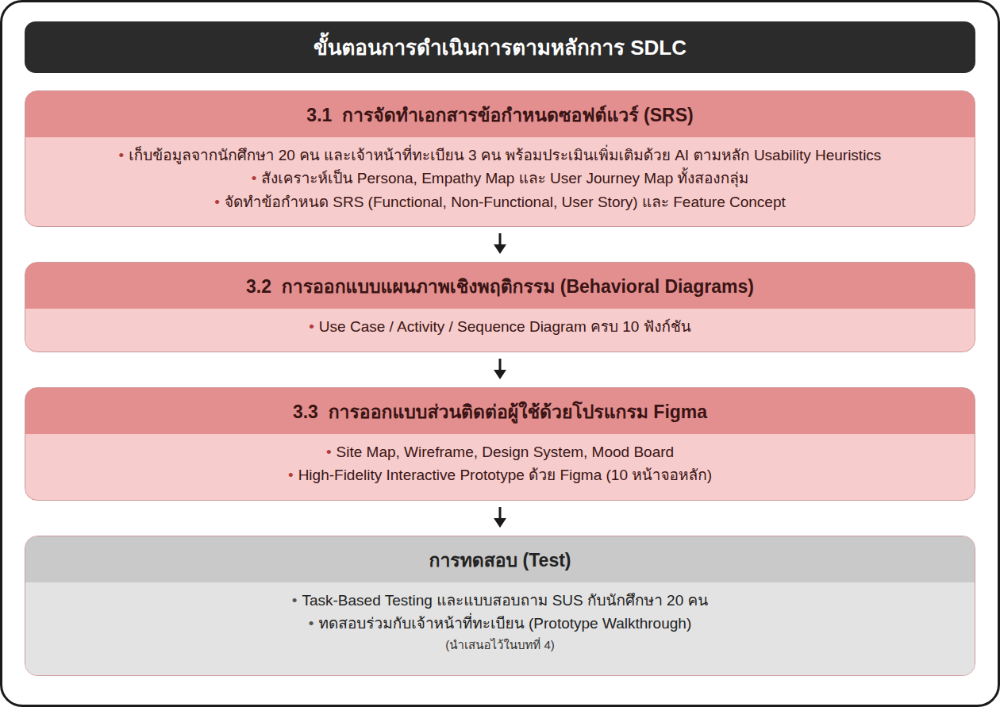

# 01 — Overview

## เป้าหมายของโปรเจกต์

ออกแบบต้นแบบแอปพลิเคชันระบบทะเบียน (UX/UI) ของมหาวิทยาลัยเทคโนโลยีราชมงคลล้านนา โดยใช้หลัก **Human-Centered Design** เพื่อแก้ปัญหาของระบบเดิม ได้แก่ เมนูซับซ้อน ใช้งานบนมือถือไม่สะดวก และไม่รู้สถานะคำร้อง

ผลงานที่ส่งต่อมีดังนี้
- High-Fidelity Interactive Prototype ใน Figma ครบ 10 ฟังก์ชัน และหน้า Login / Home
- Design System และ Design Tokens
- SRS (FR / NFR), User Story, Acceptance Criteria
- Use Case, Activity และ Sequence Diagram
- Requirement Mapping
- ผล Usability Testing

## ขอบเขต (In / Out of scope)

| In scope (ออกแบบแล้ว) | Out of scope (Developer ต้องทำต่อ) |
|---|---|
| UI/UX ของ 10 ฟังก์ชัน และ Login, Forgot Password, Home | Backend, API, Database |
| Happy Path flow ที่กดทดลองได้ใน Figma | การเชื่อมต่อระบบทะเบียนจริง และระบบชำระเงินจริง |
| ข้อความแจ้งเตือนจำลอง (ตารางซ้อน, เกินกำหนดถอน ฯลฯ) | Push notification / แจ้งเตือนผ่านช่องทางภายนอก |
| หน้าจอฝั่งนักศึกษา (Mobile-first) | หน้าจอฝั่งอาจารย์ที่ปรึกษาและเจ้าหน้าที่ทะเบียน (Back-office) |

> หมายเหตุ: Acceptance Criteria ในเอกสารเขียนเพื่อตรวจ **ต้นแบบ** (ข้อมูลจำลอง) ตอนพัฒนาจริงให้แปลงเป็นเงื่อนไขที่ทำงานกับข้อมูลจริง ดูรายละเอียดใน [09-backlog.md](09-backlog.md)

## ผู้ใช้ (Actors)

| Actor | บทบาท | ใช้ฟังก์ชัน |
|---|---|---|
| **นักศึกษา** | ผู้ใช้หลักของแอป | ทุกฟังก์ชัน |
| **อาจารย์ที่ปรึกษา** | ผู้อนุมัติระดับ 1 | UC-06 ถอนรายวิชา, UC-09 ขอสำเร็จการศึกษา |
| **เจ้าหน้าที่ทะเบียน** | ผู้อนุมัติระดับ 2 / ผู้ตรวจสอบ | UC-01 แก้ไขข้อมูลอ่อนไหว, UC-06, UC-09 |

ทุก Use Case ต้องผ่านการยืนยันตัวตน (Authenticate User) ก่อนใช้งาน

## Platform & Assumptions

| หัวข้อ | ค่าในงานออกแบบ |
|---|---|
| Platform | Mobile app รองรับทั้ง iOS และ Android (NFR-03) |
| Frame size | 375 × 812 px (iPhone X/11 Pro) |
| Login | RMUTL Account + รหัสผ่าน (มี CAPTCHA "Success!" แบบ Turnstile ในหน้า Login) |
| ภาษา | ไทยเป็นหลัก มี label อังกฤษกำกับ |
| Navigation | Hamburger menu (มุมซ้ายบน) + Bottom tab 3 ปุ่ม: หน้าแรก / ผลการเรียน / ตารางเรียน |
| Usability target | เข้าถึงเมนูหลักได้ภายใน 3 ครั้งการแตะ (NFR-01) |

## กระบวนการออกแบบ

ใช้ Design Thinking 5 ขั้นตอน ร่วมกับ SDLC เฉพาะช่วง Requirement Analysis & Design

1. **Empathize:** แบบสอบถามนักศึกษา 20 คน, สัมภาษณ์เจ้าหน้าที่ทะเบียน, Heuristic Evaluation ระบบเดิม
2. **Define:** Persona, Empathy Map, User Journey Map, SRS
3. **Ideate:** จัดลำดับความสำคัญ และ Feature Concept
4. **Prototype:** Sitemap → Wireframe → Design System → Hi-Fi Prototype
5. **Test:** Task-based testing, SUS, Prototype walkthrough กับเจ้าหน้าที่ทะเบียน
