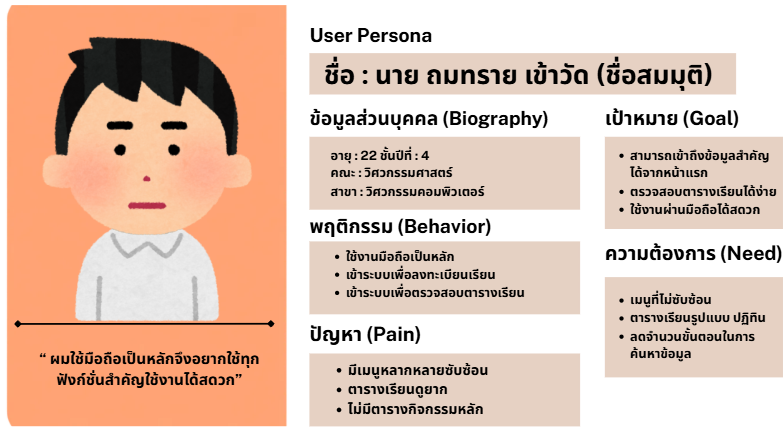
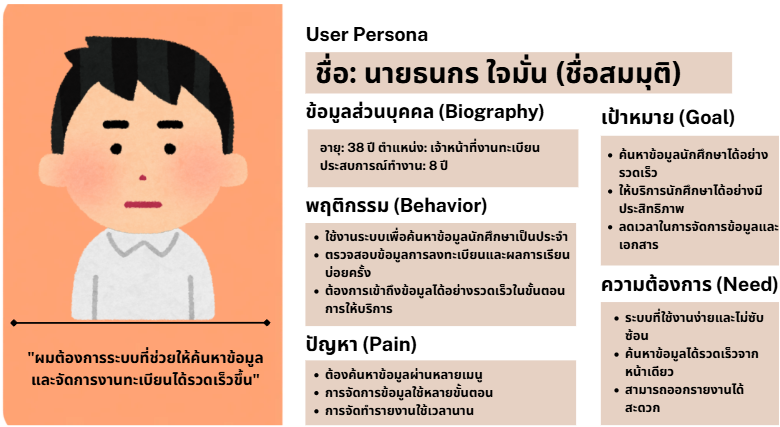
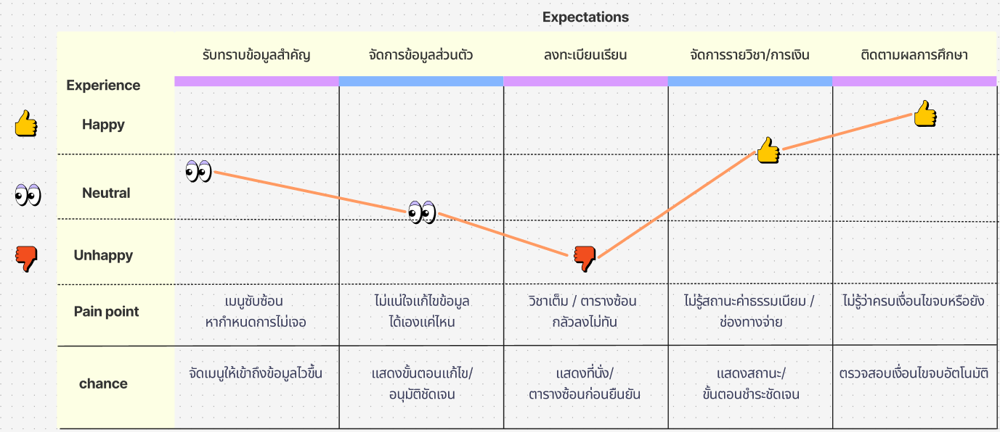
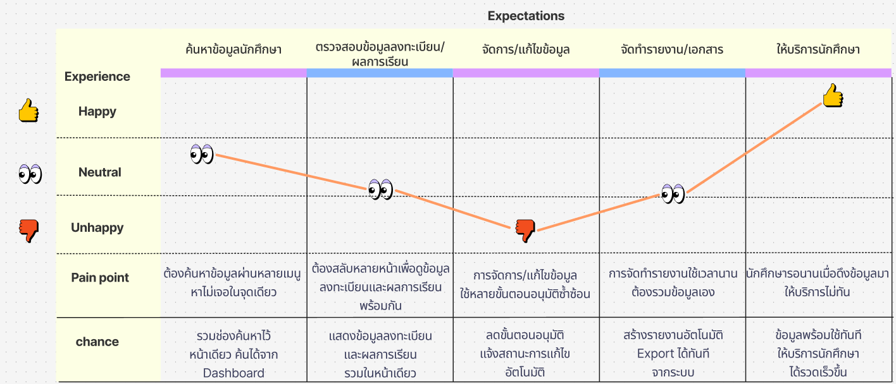

# 02 — User Research

สรุปข้อมูลผู้ใช้ที่เป็นที่มาของการตัดสินใจด้านการออกแบบ (ข้อมูลผู้ให้สัมภาษณ์ไม่ระบุตัวตน ใช้รหัส P1, P2, …)

## วิธีเก็บข้อมูล

| กลุ่ม | วิธี | จำนวน |
|---|---|---|
| นักศึกษา | แบบสอบถามออนไลน์: ข้อมูลทั่วไป, พฤติกรรมการใช้งาน, ความยากง่ายรายฟังก์ชัน (1–5), ปัญหาและความคาดหวัง | 20 คน |
| เจ้าหน้าที่ทะเบียน | สัมภาษณ์กึ่งโครงสร้าง: กระบวนการเบื้องหลังและกฎเกณฑ์ของแต่ละฟังก์ชัน (UC-01 ถึง UC-10) | 3 คน |
| ระบบเดิม | Heuristic Evaluation ด้วย AI ตาม 10 Usability Heuristics ของ Nielsen | — |

## ปัญหาของระบบเดิม (Heuristic Evaluation)

ระบบเดิมละเมิด 6 ใน 10 ข้อ

1. **Visibility of System Status:** ไม่รู้สถานะคำร้อง (ถอนวิชา, ขอจบ)
2. **Consistency and Standards:** การแสดงผลไม่สอดคล้องกัน ต้องเปิดหลายหน้าต่างเทียบข้อมูล
3. **Recognition rather than Recall:** ข้อมูลสำคัญกระจายอยู่หลายหน้า
4. **Flexibility and Efficiency of Use:** รองรับมือถือไม่ดี
5. **Aesthetic and Minimalist Design:** เมนูซับซ้อน ต้องผ่านหลายขั้นตอน
6. **Help Users Recover from Errors:** ข้อความแจ้งข้อผิดพลาดไม่ชัดเจน

## Persona

| นักศึกษา | เจ้าหน้าที่ทะเบียน |
|---|---|
|  |  |
| ใช้มือถือเป็นหลัก ต้องการเห็นข้อมูลสำคัญตั้งแต่หน้าแรก อยากได้ตารางเรียนแบบปฏิทิน | ค้นหาข้อมูลนักศึกษาทุกวัน ต้องการข้อมูลที่ใช้ตรวจสอบอยู่ครบในหน้าเดียว |

> ชื่อใน Persona เป็นชื่อสมมุติ

### เสียงจากผู้ใช้ (นักศึกษา)
- P1: "ผมใช้มือถือเป็นหลัก เวลาอยากเช็กตารางเรียนหรือเข้าไปลงทะเบียนก็จะเปิดจากมือถือ"
- P2: "เมนูมีหลายอัน เวลาอยากหาข้อมูลบางอย่างต้องกดเข้าไปหลายหน้า"
- P3: "ตารางเรียนดูค่อนข้างยาก"
- P4: อยากให้ "เปิดหน้าแรกมาแล้วเห็นตารางเรียนของวันนี้เลย"
- P5: อยากได้ "ปฏิทินที่รวมตารางเรียนกับกิจกรรมหรือกำหนดการสำคัญไว้ด้วย"

### เสียงจากผู้ใช้ (เจ้าหน้าที่ทะเบียน)
- P1: "เวลาจะหาข้อมูลของนักศึกษาสักคนต้องกดเข้าไปหลายหน้ากว่าจะเจอ"
- P2: "ต้องเปิดหลายหน้าต่างเทียบกันเพื่อดูว่าข้อมูลตรงกันไหม"
- P3: "อยากให้หน้าจอที่ใช้บ่อยๆ อย่างข้อมูลถอนวิชาหรือขอจบ แสดงรายละเอียดที่จำเป็นให้ครบในหน้าเดียว"

## Empathy Map

### นักศึกษา

| Says | Thinks | Does | Feels |
|---|---|---|---|
| "อยากดูตารางเรียนได้ง่ายกว่านี้" | ระบบควรใช้งานง่าย ไม่ซับซ้อน | ใช้งานผ่านสมาร์ตโฟนเป็นหลัก | สับสนเมื่อเจอเมนูจำนวนมาก |
| "เมนูในระบบมีเยอะเกินไป" | ตารางเรียนควรแสดงในรูปแบบที่เข้าใจง่าย | ตรวจสอบตารางเรียนก่อนเข้าเรียน | เสียเวลาเมื่อค้นหาตารางเรียน |
| "ใช้งานผ่านมือถือเป็นหลัก" | ข้อมูลที่ใช้บ่อยควรหาเจอได้เร็ว | ค้นหาข้อมูลรายวิชาและกำหนดการ | ไม่สะดวกเมื่อใช้ผ่านมือถือ |
| "อยากเห็นข้อมูลสำคัญตั้งแต่หน้าแรก" | การใช้งานบนมือถือควรสะดวกกว่านี้ | เข้าระบบเฉพาะช่วงลงทะเบียน/ดูผลการเรียน | พึงพอใจเมื่อเข้าถึงข้อมูลได้เร็ว |

### เจ้าหน้าที่ทะเบียน

| Says | Thinks | Does | Feels |
|---|---|---|---|
| "อยากค้นหาข้อมูลนักศึกษาได้เร็วกว่านี้" | ระบบที่ดีควรช่วยลดเวลาทำงาน | ค้นหาข้อมูลนักศึกษาทุกวัน | เสียเวลาเมื่อต้องค้นผ่านหลายเมนู |
| "การออกรายงานน่าจะทำได้ง่ายกว่านี้" | อยากค้นหาข้อมูลได้จากหน้าเดียว | ตรวจสอบการลงทะเบียนและผลการเรียน | ไม่สะดวกเมื่องานเดียวมีหลายขั้นตอน |
| "อยากให้ข้อมูลที่ต้องใช้อยู่รวมในที่เดียว" | ข้อมูลต้องถูกต้องและเข้าถึงได้ทันที | จัดการข้อมูลผ่านคอมพิวเตอร์ทุกวัน | กังวลเมื่อต้องเทียบข้อมูลหลายหน้าจอ |
| "ขั้นตอนไม่ควรซ้ำซ้อนแบบนี้" | หน้าจอที่ใช้บ่อยควรครบในหน้าเดียว | จัดทำรายงานและเอกสารทางการศึกษา | พึงพอใจเมื่อค้นหาได้เร็วและถูกต้อง |

## User Journey Map

### นักศึกษา

| ขั้นตอน | Touchpoint | Pain Point | Opportunity |
|---|---|---|---|
| 1. รับทราบข้อมูลสำคัญ | FR-02, FR-03 | เมนูซับซ้อน หากำหนดการยาก | จัดเมนูให้เข้าถึงข้อมูลเร็วขึ้น |
| 2. จัดการข้อมูลส่วนตัว | FR-01 | ไม่แน่ใจว่าแก้ข้อมูลเองได้ไหม | แสดงชัดว่าข้อมูลใดแก้เองได้ ข้อมูลใดต้องรออนุมัติ |
| 3. ลงทะเบียนเรียน | FR-04, FR-05, FR-07 | วิชาเต็ม / ตารางซ้อน กลัวลงไม่ทัน | แสดงที่นั่งและเตือนตารางซ้อนก่อนยืนยัน |
| 4. จัดการรายวิชา/การเงิน | FR-06, FR-10 | ไม่รู้สถานะค้างชำระและช่องทางชำระ | แสดงสถานะและขั้นตอนชำระให้ชัด |
| 5. ติดตามผลการศึกษา | FR-08, FR-09 | ไม่รู้ว่าเงื่อนไขจบครบหรือยัง | ตรวจเงื่อนไขจบอัตโนมัติและแสดงสถานะ |

ความพึงพอใจต่ำสุดอยู่ที่ขั้นตอนที่ 3 (ลงทะเบียนเรียน)

### เจ้าหน้าที่ทะเบียน

| ขั้นตอน | Pain Point | Opportunity |
|---|---|---|
| 1. ตรวจ/อนุมัติแก้ไขข้อมูลส่วนตัว (UC-01) | ต้องค้นและเทียบข้อมูลหลายเมนู | รวมข้อมูลที่ต้องตรวจไว้ในหน้าเดียว |
| 2. แก้ปัญหาลงทะเบียนรายกรณี (UC-05) | จำนวนที่นั่งในระบบไม่ตรงจริง | แสดงที่นั่งและสถานะให้ตรวจง่าย |
| 3. อนุมัติคำร้องถอนรายวิชา (UC-06) | ต้องสลับหน้าจอหลายจุด | จัดข้อมูลคำร้องให้ครบในหน้าเดียว |
| 4. ตรวจผลการเรียน/คุณสมบัติจบ (UC-09) | ต้องเทียบเอกสารหลายแหล่ง | รวมเกรดและเงื่อนไขจบไว้ในหน้าเดียว |
| 5. ติดตามการชำระเงิน/หนี้สิน (UC-10) | ต้องเปิดหลายหน้าเพื่อออกรายงาน | แสดงสถานะและออกรายงานจากหน้าเดียว |

## Business rules จากการสัมภาษณ์เจ้าหน้าที่ทะเบียน

กฎเหล่านี้ต้องนำไปทำใน Backend
- **ข้อมูลส่วนตัว:** ข้อมูลทั่วไป (ที่อยู่, เบอร์โทร) แก้ได้ทันที ข้อมูลอ่อนไหว (ชื่อ-สกุล, เลขบัตรประชาชน) ต้องส่งคำร้องให้เจ้าหน้าที่ทะเบียนอนุมัติ
- **ถอนรายวิชา:** อนุมัติ 2 ระดับ คืออาจารย์ที่ปรึกษา แล้วจึงเจ้าหน้าที่ทะเบียน ถ้าถอนสำเร็จบันทึกเป็น **W** และต้องถอนภายในช่วงเวลาที่กำหนด
- **ขอสำเร็จการศึกษา:** ตรวจหน่วยกิต, GPA และโครงสร้างหลักสูตรอัตโนมัติ ถ้าไม่ครบเงื่อนไขให้ปิดปุ่มยื่นคำร้อง เจ้าหน้าที่ใช้เวลาตรวจเฉลี่ย **1–2 สัปดาห์ต่อคำร้อง**
- **ชำระเงิน:** มี 3 สถานะ คือ ชำระผ่านธนาคาร / รอดำเนินการ / ไม่ชำระเงิน ช่องทางชำระคือเลขบัญชีธนาคารและ QR Code (ชำระนอกระบบ)
