# 04 — Use Cases

ทุก Use Case เริ่มจากการ **เข้าสู่ระบบ (Authenticate User)** แล้วจึงไปหน้าแรก จากนั้นเลือกเมนูจาก Hamburger menu หรือปุ่มลัดบน Home

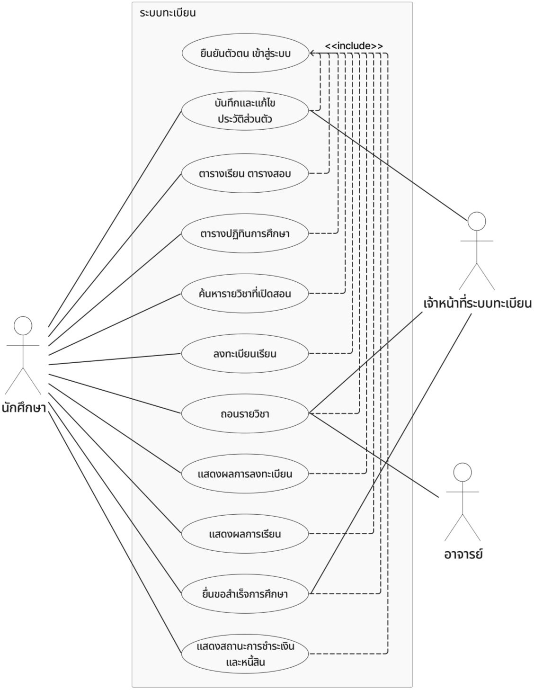

## สรุป Use Case

| ID | Use Case | Actor |
|---|---|---|
| [UC-01](#uc-01-บันทึกและแก้ไขประวัติส่วนตัว) | บันทึกและแก้ไขประวัติส่วนตัว | นักศึกษา, เจ้าหน้าที่ทะเบียน |
| [UC-02](#uc-02-ตารางเรียน-ตารางสอบ) | ตารางเรียน ตารางสอบ | นักศึกษา |
| [UC-03](#uc-03-ปฏิทินการศึกษา) | ปฏิทินการศึกษา | นักศึกษา |
| [UC-04](#uc-04-ค้นหารายวิชาที่เปิดสอน) | ค้นหารายวิชาที่เปิดสอน | นักศึกษา |
| [UC-05](#uc-05-ลงทะเบียนเรียน) | ลงทะเบียนเรียน | นักศึกษา |
| [UC-06](#uc-06-ถอนรายวิชา) | ถอนรายวิชา | นักศึกษา (ผู้ยื่น), อาจารย์ที่ปรึกษา (อนุมัติระดับ 1), เจ้าหน้าที่ทะเบียน (อนุมัติระดับ 2) |
| [UC-07](#uc-07-แสดงผลการลงทะเบียน) | แสดงผลการลงทะเบียน | นักศึกษา |
| [UC-08](#uc-08-แสดงผลการเรียน) | แสดงผลการเรียน | นักศึกษา |
| [UC-09](#uc-09-ยื่นขอสำเร็จการศึกษา) | ยื่นขอสำเร็จการศึกษา | นักศึกษา (ผู้ยื่น), อาจารย์/เจ้าหน้าที่ทะเบียน (ผู้ตรวจสอบ) |
| [UC-10](#uc-10-แสดงสถานะการชำระเงินและหนี้สิน) | แสดงสถานะการชำระเงินและหนี้สิน | นักศึกษา |

---

## UC-01 บันทึกและแก้ไขประวัติส่วนตัว

**Screen:** SCR-01 · **FR:** FR-01 · **US:** US-01

**Main flow**
1. เลือกเมนู "บันทึกและแก้ไขประวัติ" จาก Hamburger menu
2. เลือกหมวด: ข้อมูลนักศึกษา / ประวัติส่วนตัว / ประวัติครอบครัว / ประวัติการศึกษา แล้วระบบแสดงข้อมูลปัจจุบัน
3. กด "แก้ไข" ระบบเปิดฟอร์มที่ prefill ข้อมูลเดิมไว้
4. ระบบตรวจความครบถ้วน (**Check Completeness**) ถ้าไม่ครบ แจ้งเตือนและให้กรอกใหม่
5. ระบบตรวจว่าเป็นข้อมูลอ่อนไหวหรือไม่ (**Check Sensitive Data**)
   - **ไม่ใช่** (ที่อยู่, เบอร์โทร): บันทึกทันที แสดง "บันทึกสำเร็จ"
   - **ใช่** (ชื่อ-สกุล, เลขบัตรประชาชน): ส่งคำร้อง แสดง "ส่งคำร้องให้เจ้าหน้าที่ทะเบียนอนุมัติ" แล้วเจ้าหน้าที่ตรวจสอบและอนุมัติ

| Activity | Sequence |
|---|---|
| 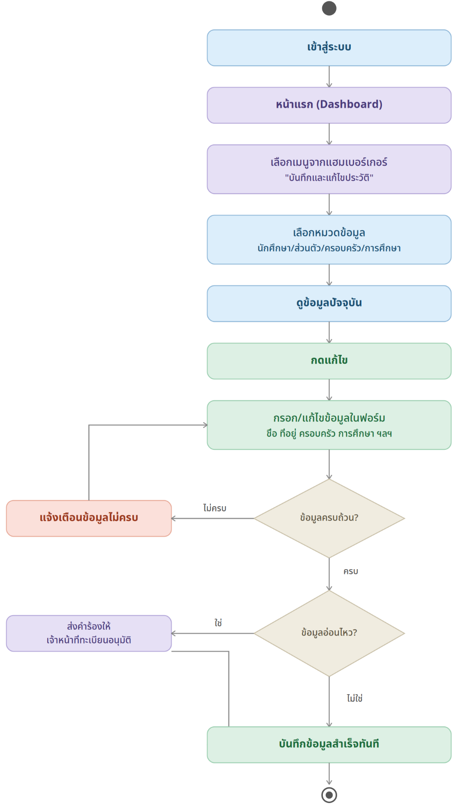 | 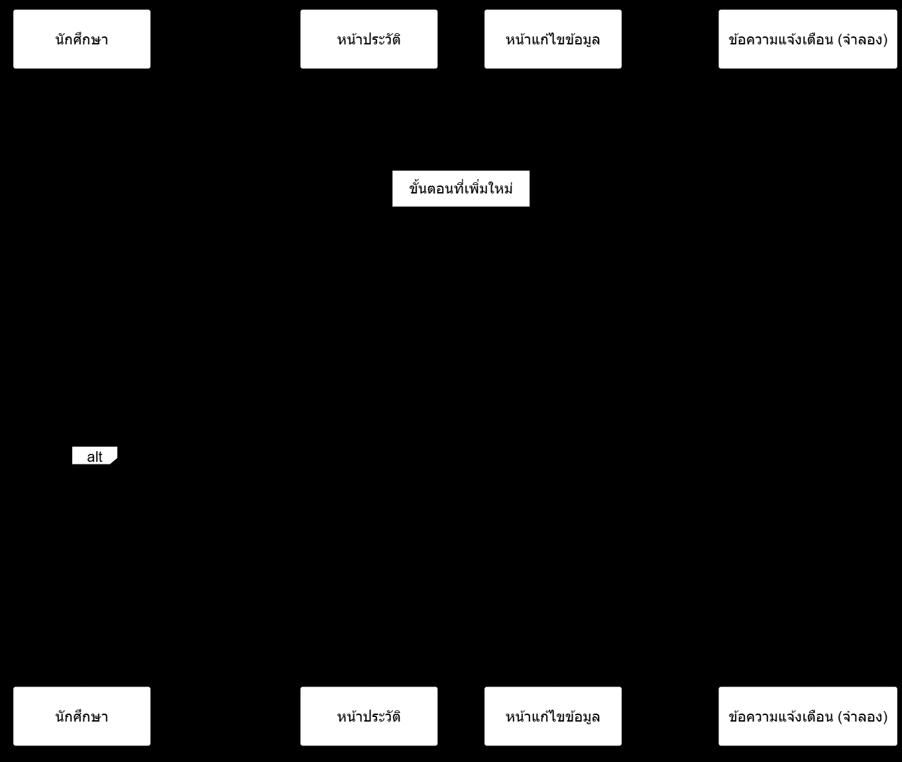 |

---

## UC-02 ตารางเรียน ตารางสอบ

**Screen:** SCR-02 · **FR:** FR-02 · **US:** US-02

1. เลือกเมนู "ตารางเรียน ตารางสอบ" แล้วเลือกภาคเรียน/ปีการศึกษา
2. เลือกแท็บ "ตารางเรียน" หรือ "ตารางสอบ"
3. **ตารางเรียน:** เลือกวัน (จ–อา) แล้วแสดงรายวิชาของวันนั้น
4. **ตารางสอบ:** เลือกช่วงสอบ (กลางภาค / ปลายภาค) แล้วแสดงวันที่ เวลา ห้องสอบ อาจารย์ผู้คุมสอบ ถ้า **ยังไม่ประกาศ** ให้แจ้งเตือน
5. (Optional) กด "ดาวน์โหลดตารางเรียน"

| Activity | Sequence |
|---|---|
| 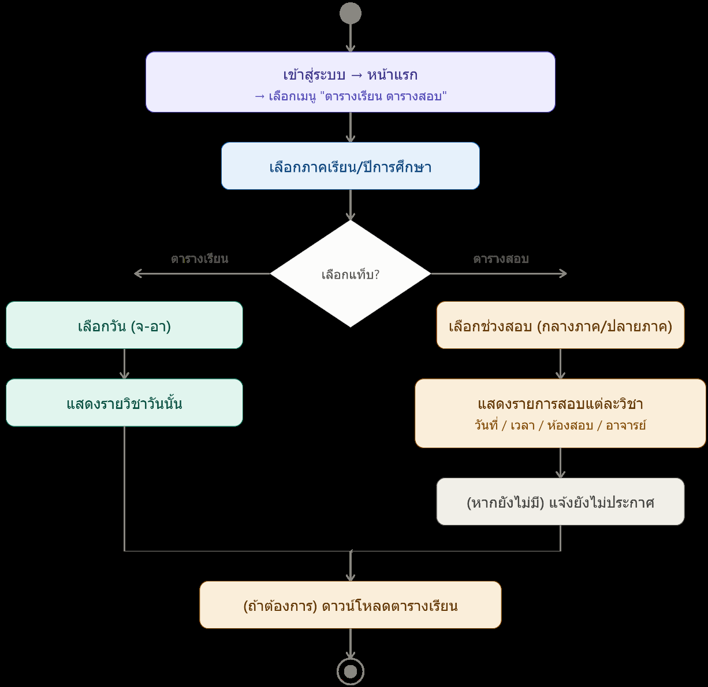 | 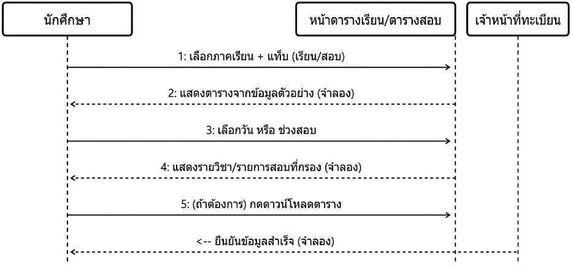 |

---

## UC-03 ปฏิทินการศึกษา

**Screen:** SCR-03 · **FR:** FR-03 · **US:** US-03

1. เลือกเมนู "ปฏิทินการศึกษา" แล้วเลือกปีการศึกษา
2. เลือก ภาคเรียนที่ 1 / ภาคเรียนที่ 2 / ภาคฤดูร้อน
3. แสดงกำหนดการทั้งหมดของภาค และ **ไฮไลต์ "ช่วงเวลาปัจจุบัน"** (ไม่มี decision branch)

| Activity | Sequence |
|---|---|
| 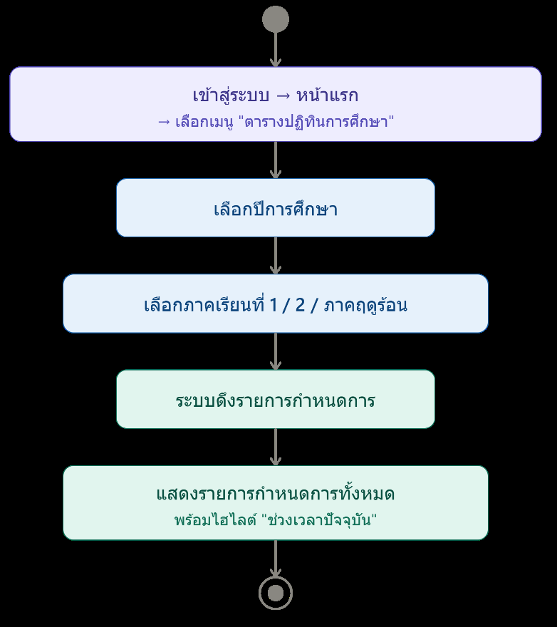 | 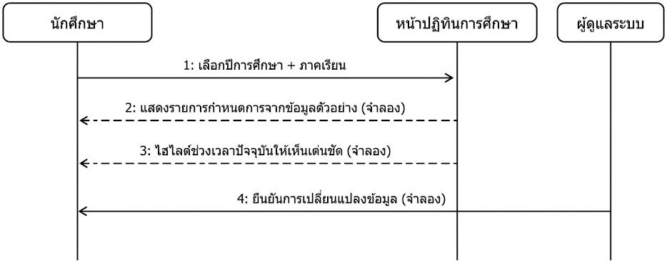 |

---

## UC-04 ค้นหารายวิชาที่เปิดสอน

**Screen:** SCR-04 · **FR:** FR-04 · **US:** US-04

1. เลือกเมนู "ค้นหารายวิชาที่เปิดสอน" แล้วเลือกเขตพื้นที่และเทอม/ปี
2. กรอกรหัสหรือชื่อวิชา (เปิด "ตัวเลือกค้นหาเพิ่มเติม" ได้)
3. กด Search ระบบตรวจผล (**Check Result**)
   - **ไม่พบ:** แสดง "ไม่พบรายวิชา"
   - **พบ:** แสดงรายการวิชา กดไอคอนแว่นขยายเพื่อไปหน้า Course Detail

| Activity | Sequence |
|---|---|
| 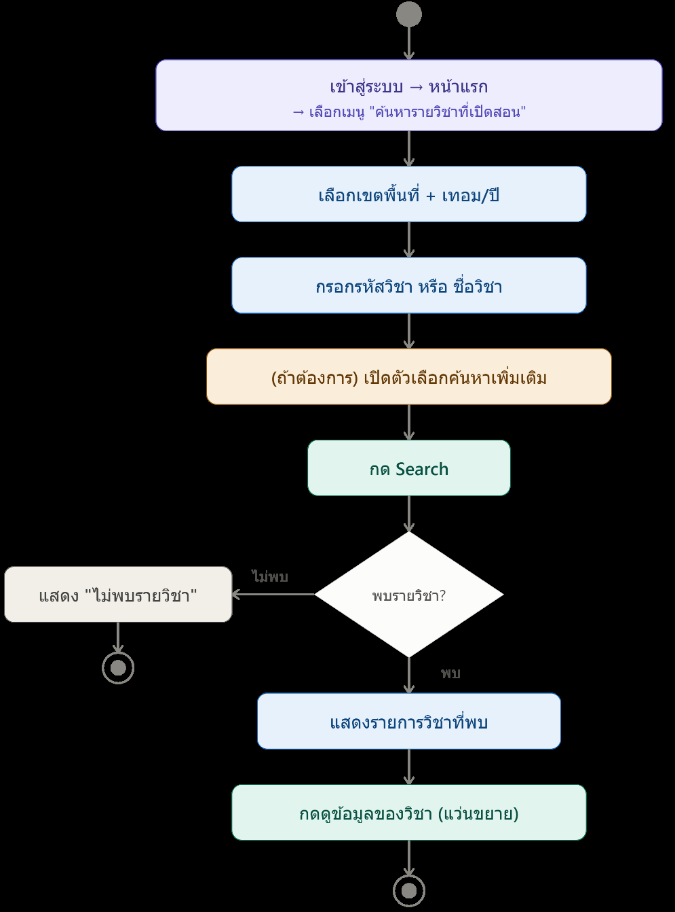 | 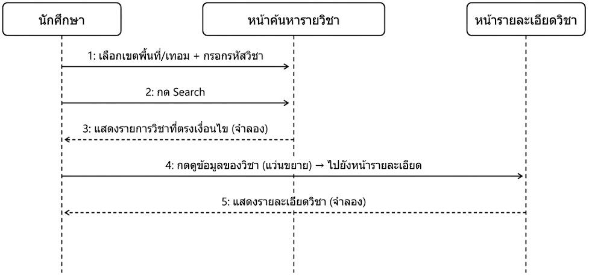 |

---

## UC-05 ลงทะเบียนเรียน

**Screen:** SCR-05 · **FR:** FR-05 · **US:** US-05 · **Priority: Highest**

1. เลือกเมนู "ลงทะเบียนเรียน" แล้วแสดง **เงื่อนไขการลงทะเบียน**
   - **ไม่ยอมรับ:** ออกจากหน้าลงทะเบียน
2. **ยอมรับ:** ค้นหาวิชาตามเขตพื้นที่, เทอม/ปี หรือรหัสวิชา
3. ระบบตรวจที่นั่ง (**Check Seat Status**) ถ้า **เต็ม** หรือ **ตารางทับซ้อน** ให้แจ้งเตือนแล้วกลับไปค้นหาใหม่
4. มีที่ว่าง: ดูข้อมูลวิชา เลือก **ลงแบบปกติ** หรือ **ลงแบบเสรี** แล้วกดยืนยัน
5. ระบบตรวจซ้ำ (**Confirm**) ถ้าไม่ถูกต้องให้กลับไปเลือกใหม่
6. ถูกต้อง: บันทึก แล้วไปหน้า "ลงทะเบียนสำเร็จ"

**Sequence (หน้าจอ):** Select Course → Review (เตือนตารางซ้อน) → Confirm → Result

| Activity | Sequence |
|---|---|
| 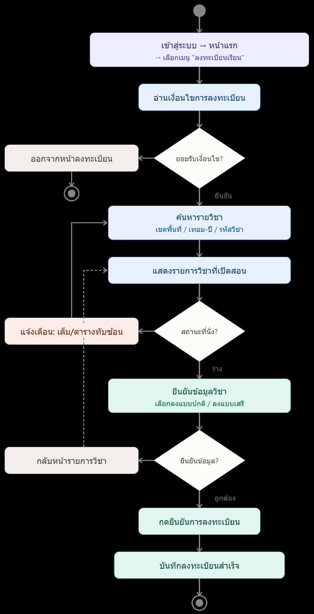 | 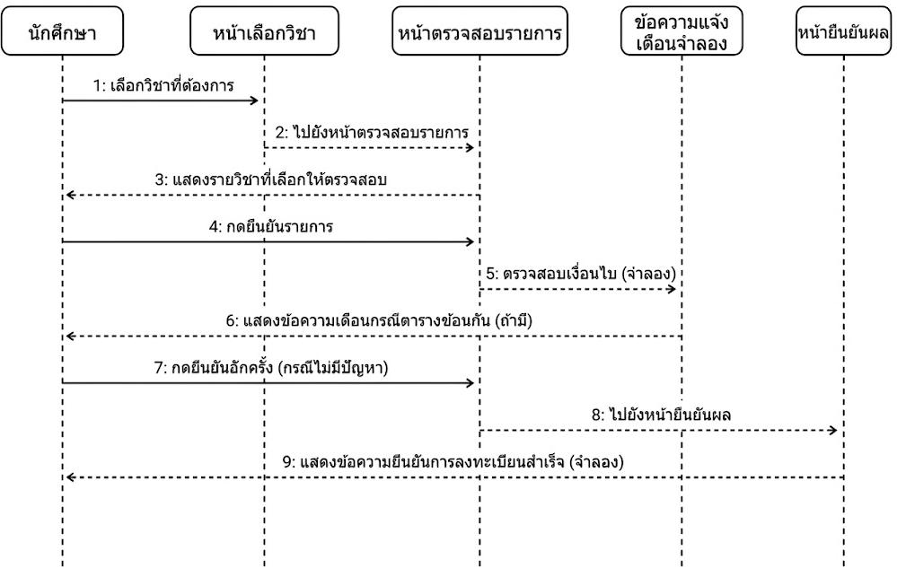 |

---

## UC-06 ถอนรายวิชา

**Screen:** SCR-06 · **FR:** FR-06 · **US:** US-06 · **Priority: Highest**

1. เลือกเมนู "ถอนรายวิชา" ระบบตรวจว่ามีวิชาที่ลงไว้ไหม (**Check Registration**) ถ้าไม่มีให้แจ้งเตือนแล้วจบ
2. เลือกวิชา กด "ถอนรายวิชา" ระบุเหตุผล แล้วยืนยันใน Popup (ยกเลิก = กลับหน้ารายการ)
3. ระบบตรวจช่วงเวลาถอน ถ้า **เกินกำหนด** ให้แจ้งเตือน
4. ส่งคำร้อง สถานะเป็น **"รออาจารย์ที่ปรึกษาอนุมัติ"**
5. **อาจารย์ที่ปรึกษา** ตรวจ ถ้าไม่อนุมัติ แจ้ง "คำร้องถูกปฏิเสธ"
6. อนุมัติแล้วส่งต่อให้ **เจ้าหน้าที่ทะเบียน** ยืนยัน ถ้าไม่ยืนยัน แจ้ง "คำร้องถูกปฏิเสธ"
7. ยืนยันแล้ว บันทึก **W** และแจ้งนักศึกษา

**State machine (แนะนำ):**
```
DRAFT → PENDING_ADVISOR → PENDING_REGISTRAR → APPROVED (W)
              ↓                    ↓
           REJECTED             REJECTED
```

| Activity | Sequence |
|---|---|
| 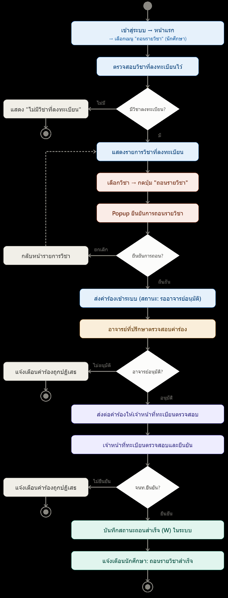 | 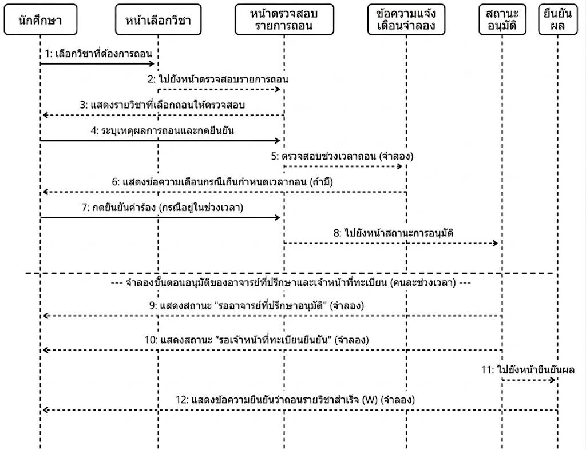 |

---

## UC-07 แสดงผลการลงทะเบียน

**Screen:** SCR-07 · **FR:** FR-07 · **US:** US-07

1. เลือกเมนู "แสดงผลลงทะเบียน" ระบบดึงภาคเรียนปัจจุบัน
2. ตรวจว่ามีวิชาที่ลงไว้ไหม (**Check Registration**)
   - **ไม่มี:** แสดง "ยังไม่ได้ลงทะเบียน"
   - **มี:** แสดงรายวิชาพร้อม badge สถานะ (**ลงปกติ / ลงทะเบียนสำเร็จ / อนุมัติ**) กดแว่นขยายเพื่อดูรายละเอียด

| Activity | Sequence |
|---|---|
| 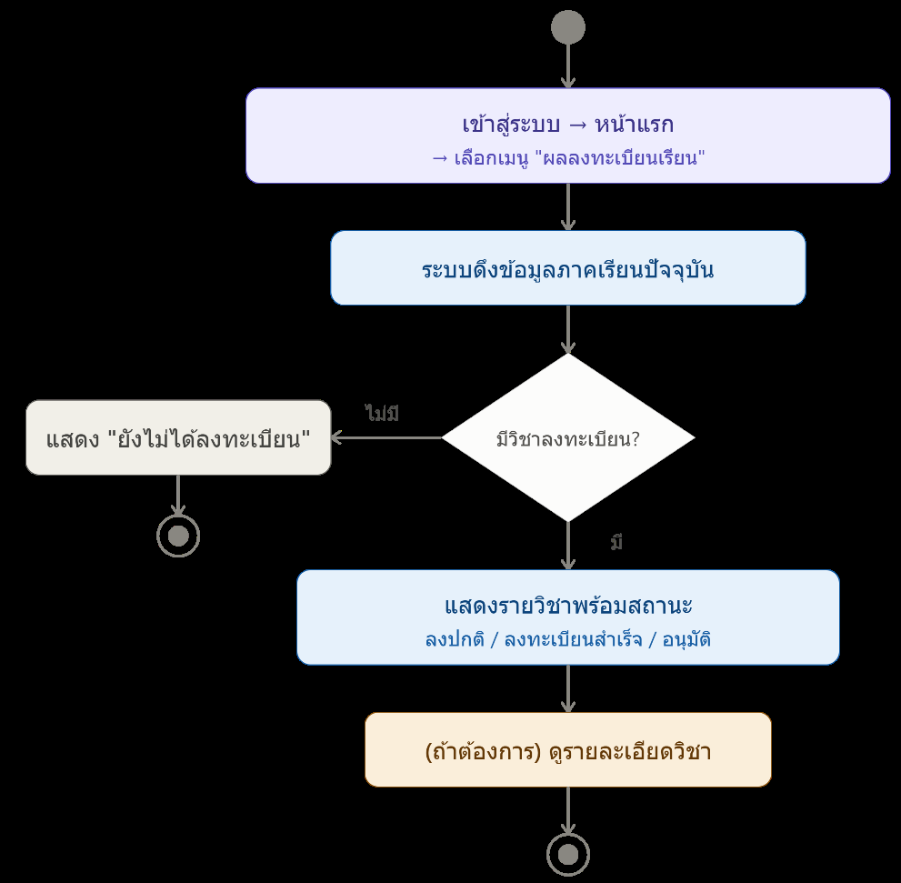 | 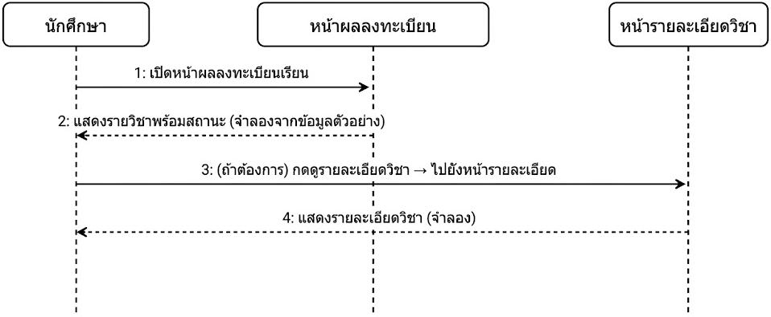 |

---

## UC-08 แสดงผลการเรียน

**Screen:** SCR-08 · **FR:** FR-08 · **US:** US-08

1. เลือกเมนู "ผลการเรียน" เลือกภาคเรียน/ปีการศึกษา แล้วกด Show
2. ตรวจว่าประกาศผลแล้วหรือยัง (**Check Announcement**)
   - **ยัง:** แสดง "ยังไม่ประกาศผล"
   - **แล้ว:** แสดงรายวิชา, หน่วยกิต, ผลคะแนน, เกรด (รวม W และ F), GPA รายภาค และสะสม
3. (Optional) พิมพ์ใบแสดงผลการเรียน (Document Preview)

หน้าจอมีกล่อง **ประกาศสำคัญ / Notices** เรื่องเกรด N (อาจารย์ยังไม่ส่งเกรด)

| Activity | Sequence |
|---|---|
| 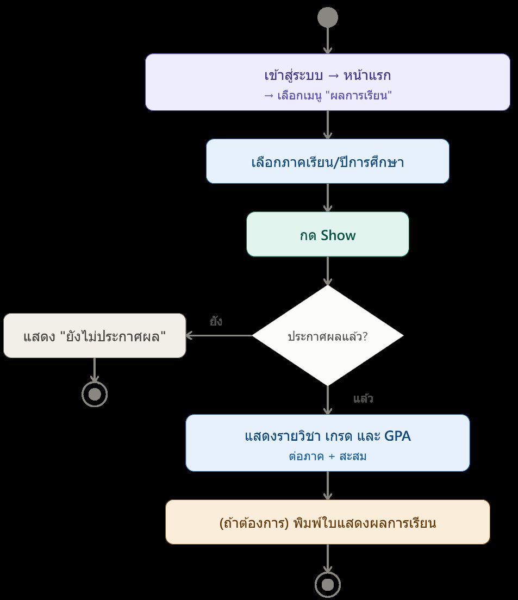 | 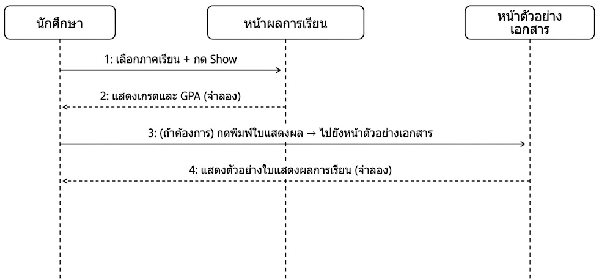 |

---

## UC-09 ยื่นขอสำเร็จการศึกษา

**Screen:** SCR-09 · **FR:** FR-09 · **US:** US-09

1. เลือกเมนู "ขอสำเร็จการศึกษา"
2. ระบบตรวจเงื่อนไขจบอัตโนมัติจากหน่วยกิต, GPA และโครงสร้างหลักสูตร (**Check Eligibility**) แล้วแสดงรายงานความคืบหน้า (เช่น 109/135 หน่วยกิต แยกตามหมวดวิชา)
   - **ไม่ครบ:** แสดงเฉพาะรายงานความคืบหน้า ปุ่มยื่นคำร้องเป็น **disabled**
   - **ครบ:** กรอกเบอร์โทรศัพท์ กด "ยื่นขอสำเร็จการศึกษา" แล้วไปหน้า Approval Status
3. สถานะ **"รอดำเนินการ"** (เจ้าหน้าที่ใช้เวลาตรวจ 1–2 สัปดาห์) → **"อนุมัติสำเร็จ"**

| Activity | Sequence |
|---|---|
| 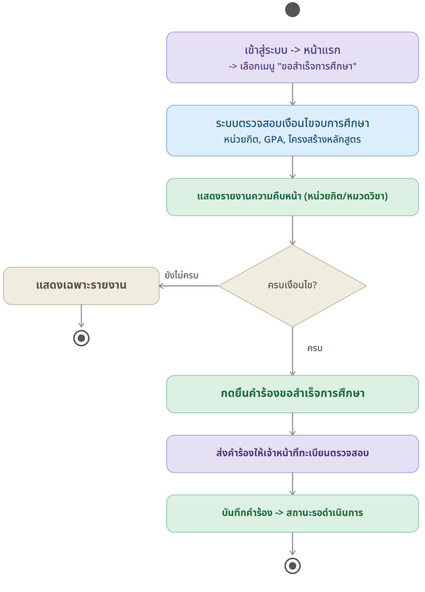 | 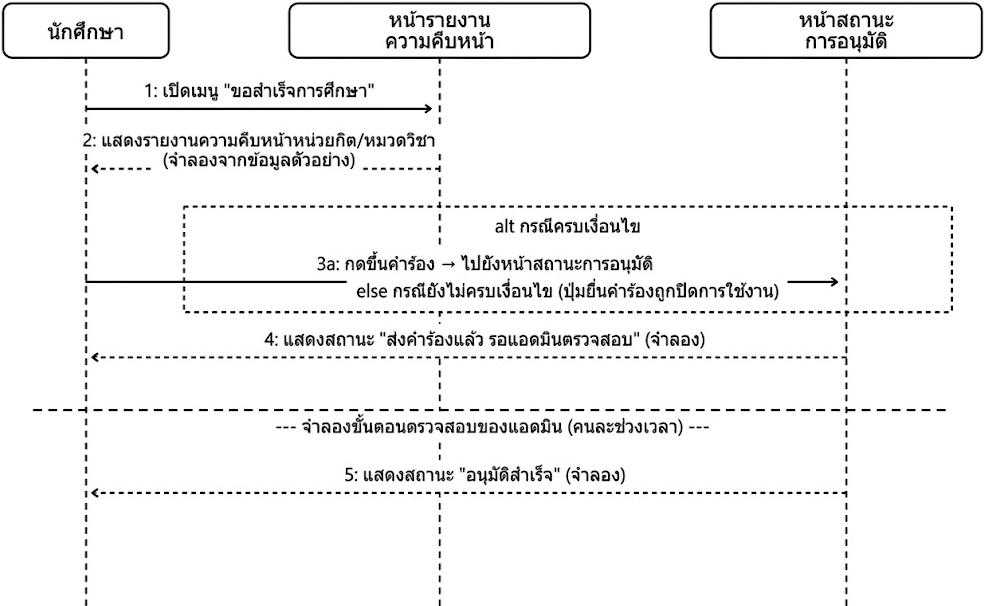 |

---

## UC-10 แสดงสถานะการชำระเงินและหนี้สิน

**Screen:** SCR-10 · **FR:** FR-10 · **US:** US-10 · **Priority: High**

1. เลือกเมนู "การชำระเงิน" ระบบดึงประวัติทุกภาคเรียนมาแสดงเป็นรายการย่อ
2. กดขยาย (▾) เพื่อดูสถานะการลงทะเบียน ยอดเงินรวม และเลขที่ใบเสร็จ
3. แสดงตามสถานะการจ่ายเงิน (**Check Payment Status**)
   - ✅ **ชำระผ่านธนาคาร:** ปุ่ม "พิมพ์ใบเสร็จรับเงิน"
   - ⏳ **รอดำเนินการ:** ปุ่ม "ใบแจ้งชำระเงิน" แสดงเลขบัญชีธนาคารมหาวิทยาลัยและ QR Code (ชำระนอกระบบ)
   - ❌ **ไม่ชำระเงิน:** แสดงป้ายสถานะเท่านั้น ถ้าพ้นกำหนดให้แสดง "หมดเวลาชำระเงิน"

| Activity | Sequence |
|---|---|
| 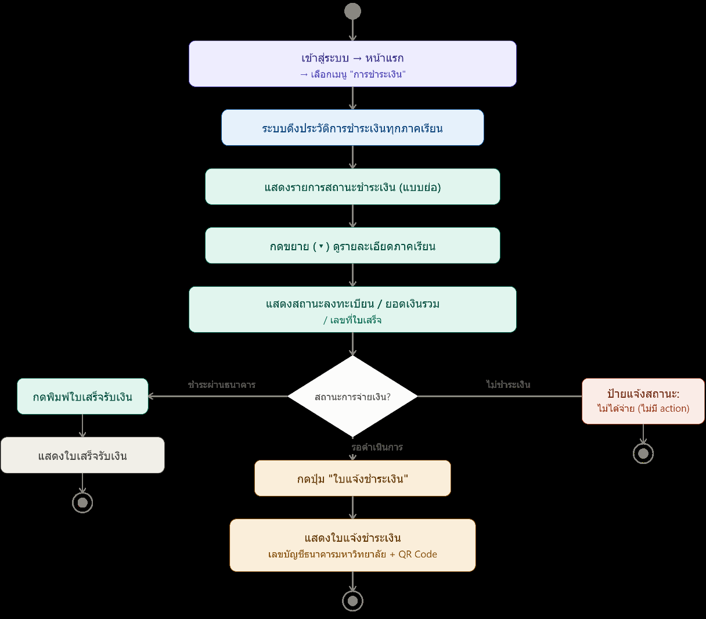 | 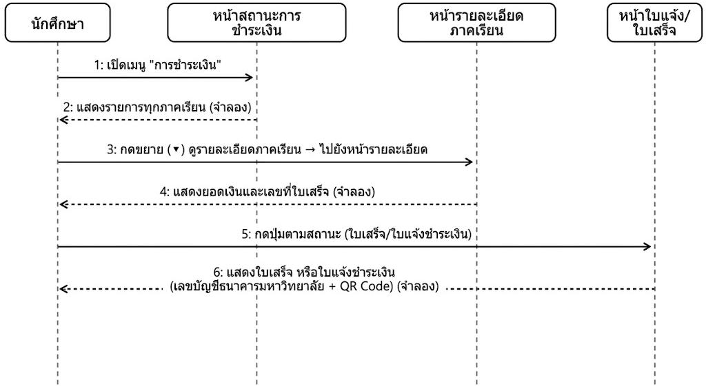 |
