# 05 — Screens

ขนาด Frame: **375 × 812 px** · ภาพทั้งหมดอยู่ใน [`design/screens/`](../design/screens) (Hi-Fi) และ [`design/wireframes/`](../design/wireframes) (Grayscale)
ค่า spacing และขนาดจริงให้ดูจาก Figma Dev Mode

> ข้อมูลส่วนบุคคลในภาพ (ชื่อ, รหัส, อีเมล, รูปถ่าย, ชื่ออาจารย์) เปลี่ยนเป็นข้อมูลตัวอย่างแล้ว

## Sitemap

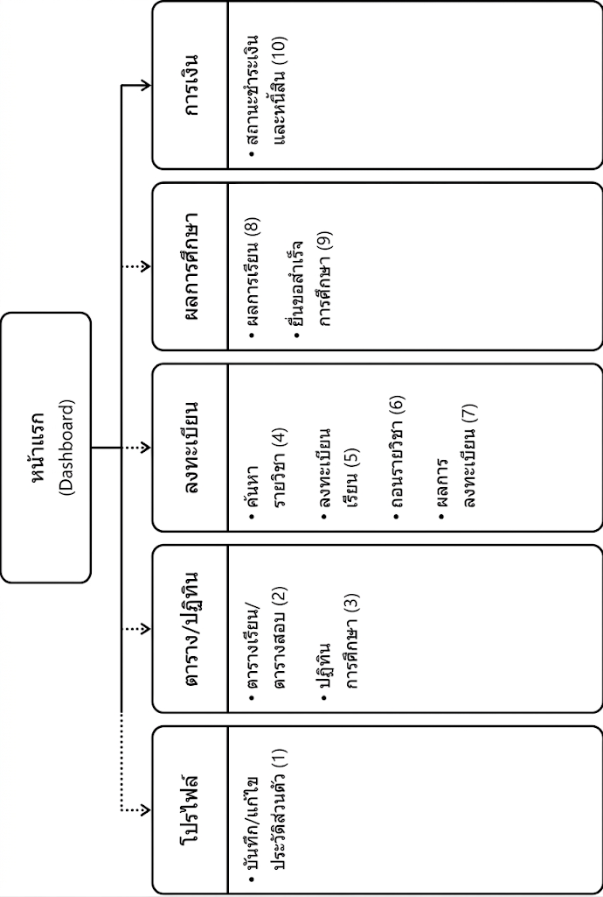

## Navigation pattern

- **App bar:** Hamburger menu (ซ้าย) · ชื่อหน้า · รูปโปรไฟล์ หรือกระดิ่งแจ้งเตือน (ขวา)
- **Bottom tab bar (3 แท็บ):** หน้าแรก · ผลการเรียน · ตารางเรียน
- **Hamburger menu:** บันทึกและแก้ไขประวัติ, ลงทะเบียนเรียน, ผลลงทะเบียนเรียน, สถานะการชำระเงิน, ถอนรายวิชา, ผลการเรียน, ขอสำเร็จการศึกษา, ตารางปฏิทินการศึกษา, ตารางเรียน ตารางสอบ, ค้นหารายวิชาที่เปิดสอน

## Screen inventory

| Screen ID | หน้าจอ | FR / UC | ไฟล์ภาพ |
|---|---|---|---|
| — | Login | Auth | `00a-login.png` |
| — | Home / Dashboard | — | `00b-home.png` |
| SCR-01 | บันทึกและแก้ไขประวัติ (4 แท็บ) | FR-01 / UC-01 | `SCR-01a…d` |
| SCR-02 | ตารางเรียน ตารางสอบ | FR-02 / UC-02 | `SCR-02-schedule.png` |
| SCR-03 | ปฏิทินการศึกษา | FR-03 / UC-03 | `SCR-03-academic-calendar.png` |
| SCR-04 | ค้นหารายวิชาที่เปิดสอน | FR-04 / UC-04 | `SCR-04-course-search.png` |
| SCR-05 | ลงทะเบียนเรียน (3 สถานะ) | FR-05 / UC-05 | `SCR-05a…c` |
| SCR-06 | ถอนรายวิชา | FR-06 / UC-06 | `SCR-06-withdraw.png` |
| SCR-07 | แสดงผลการลงทะเบียน | FR-07 / UC-07 | `SCR-07-enrollment-result.png` |
| SCR-08 | แสดงผลการเรียน | FR-08 / UC-08 | `SCR-08-grade-report.png` |
| SCR-09 | ยื่นขอสำเร็จการศึกษา | FR-09 / UC-09 | `SCR-09-graduation-request.png` |
| SCR-10 | สถานะการชำระเงินและหนี้สิน | FR-10 / UC-10 | `SCR-10-payment-status.png` |
| — | Forgot Password | Auth | ดูใน Figma |

---

### Login & Home

| Login | Home |
|---|---|
| 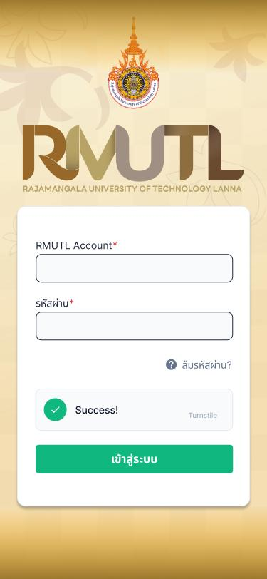 | 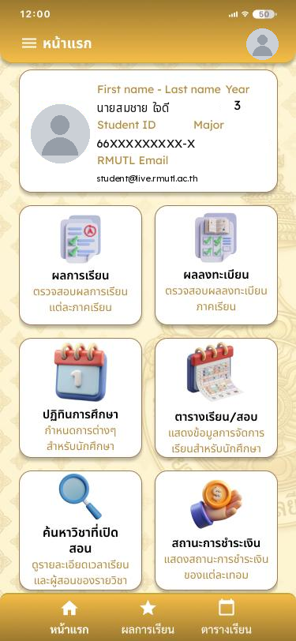 |
| กรอก RMUTL Account และรหัสผ่าน มี CAPTCHA และลิงก์ "ลืมรหัสผ่าน?" | การ์ดข้อมูลนักศึกษา (ชื่อ, ชั้นปี, รหัส, สาขา, อีเมล) และปุ่มลัด 6 ฟังก์ชัน: ผลการเรียน, ผลลงทะเบียน, ปฏิทินการศึกษา, ตารางเรียน/สอบ, ค้นหาวิชาที่เปิดสอน, สถานะการชำระเงิน |

### SCR-01 บันทึกและแก้ไขประวัติ

แท็บด้านบน 4 หมวด ได้แก่ ข้อมูลนักศึกษา / ประวัติส่วนตัว / ประวัติครอบครัว / ประวัติการศึกษา แต่ละหมวดมีปุ่มแก้ไข ลิงก์คู่มือแก้ไขข้อมูล พิมพ์ใบประวัติ/ใบรายงานตัว และดาวน์โหลดเอกสาร

| ข้อมูลนักศึกษา | ประวัติส่วนตัว | ประวัติครอบครัว | ประวัติการศึกษา |
|---|---|---|---|
| 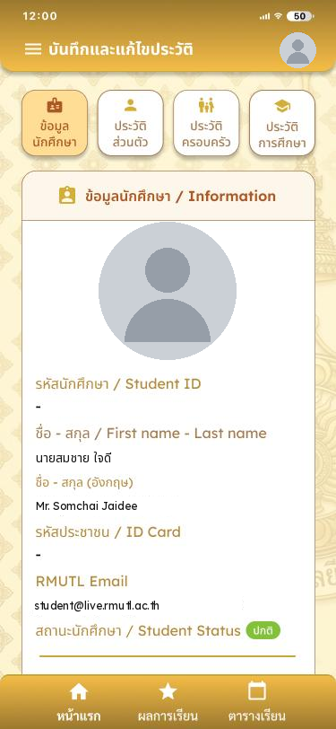 | 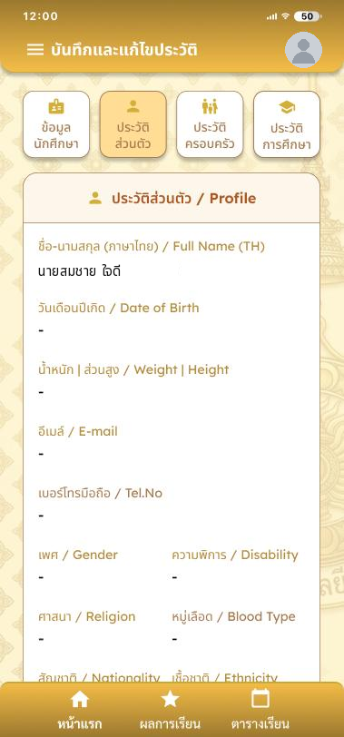 | 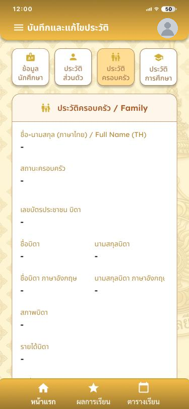 | 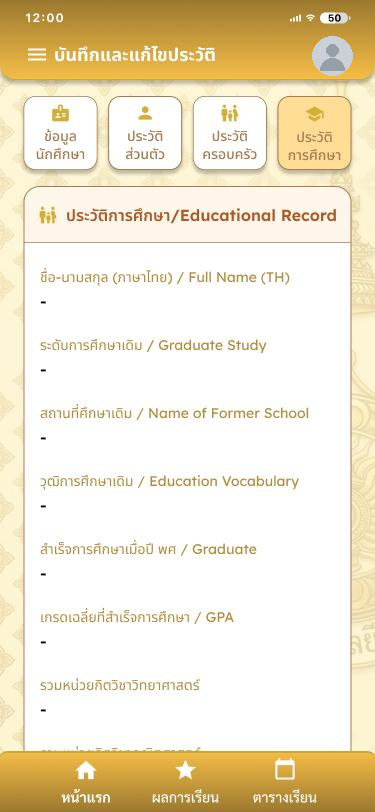 |
| รูป, รหัส, ชื่อ TH/EN, เลขบัตรประชาชน, อีเมล, สถานะนักศึกษา | ชื่อ, วันเกิด, น้ำหนัก/ส่วนสูง, อีเมล, เบอร์โทร, เพศ, ความพิการ, ศาสนา, หมู่เลือด, สัญชาติ, เชื้อชาติ, ที่อยู่ | ข้อมูลบิดา มารดา ผู้ปกครอง: ชื่อ, เลขบัตร, อาชีพ, รายได้, ที่อยู่ | ระดับการศึกษาเดิม, สถานศึกษา, วุฒิ, ปีที่จบ, GPA |

### SCR-02 / SCR-03 / SCR-04

| ตารางเรียน ตารางสอบ | ปฏิทินการศึกษา | ค้นหารายวิชา |
|---|---|---|
| 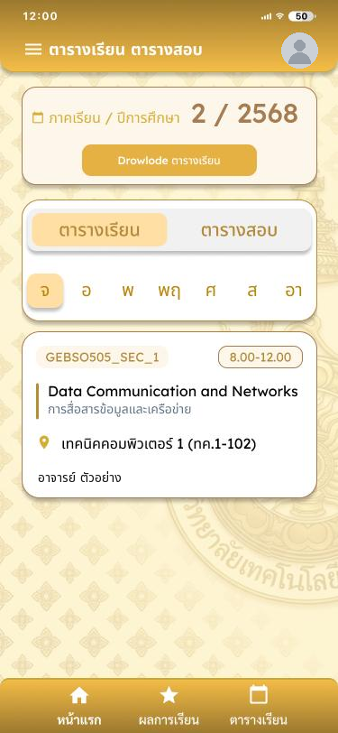 | 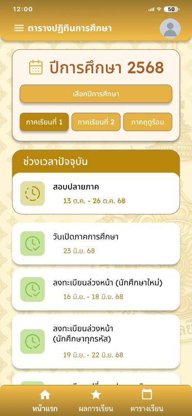 | 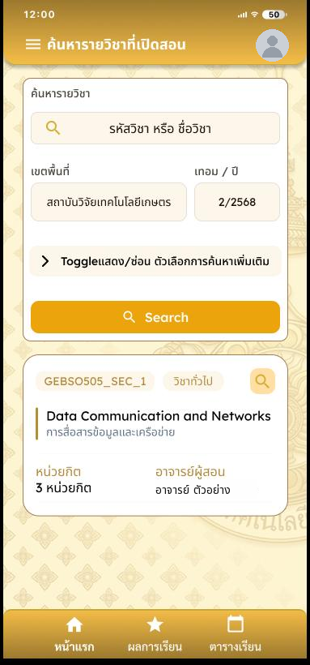 |
| เลือกภาค/ปี, ดาวน์โหลดตาราง, แท็บตารางเรียน/ตารางสอบ, เลือกวัน จ–อา, การ์ดวิชา (รหัส-section, เวลา, ห้อง, ผู้สอน) | เลือกปี, แท็บ ภาค 1 / ภาค 2 / ฤดูร้อน, กล่อง "ช่วงเวลาปัจจุบัน" แบบไฮไลต์, รายการกำหนดการพร้อมช่วงวันที่ | ช่องค้นหารหัส/ชื่อวิชา, เขตพื้นที่, เทอม/ปี, toggle ตัวเลือกเพิ่มเติม, ปุ่ม Search, การ์ดผลลัพธ์ (รหัส, ชื่อ TH/EN, หน่วยกิต, ผู้สอน) |

### SCR-05 ลงทะเบียนเรียน

| ก่อนลงทะเบียน | ข้อมูลวิชา (ก่อนยืนยัน) | หลังยืนยัน |
|---|---|---|
| 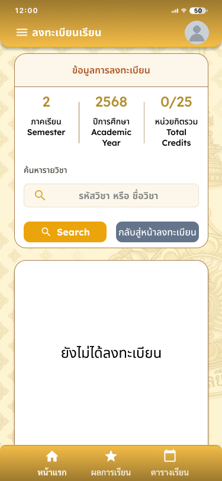 | 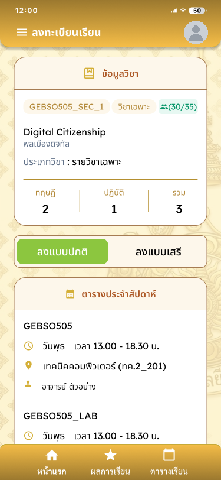 | 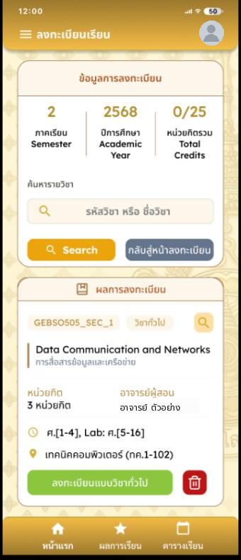 |
| สรุปภาค / ปี / หน่วยกิตรวม (0/25), ค้นหาวิชา, empty state "ยังไม่ได้ลงทะเบียน" | ประเภทวิชา, ที่นั่ง (30/35), หน่วยกิต ทฤษฎี/ปฏิบัติ, toggle **ลงแบบปกติ / ลงแบบเสรี**, ตารางประจำสัปดาห์, ตารางสอบ, รายชื่อผู้ลงทะเบียนในกลุ่ม, ปุ่มยกเลิก/ยืนยัน | รายการวิชาที่ลงแล้ว, ปุ่มลงทะเบียน, ปุ่มลบ (ถังขยะ) |

ก่อนเข้าหน้านี้จะมี modal **เงื่อนไขการลงทะเบียน** (ยกเลิก / ยืนยัน) ดูได้ใน [`design/flows/`](../design/flows)

### SCR-06 / SCR-07 / SCR-08

| ถอนรายวิชา | ผลการลงทะเบียน | ผลการเรียน |
|---|---|---|
| 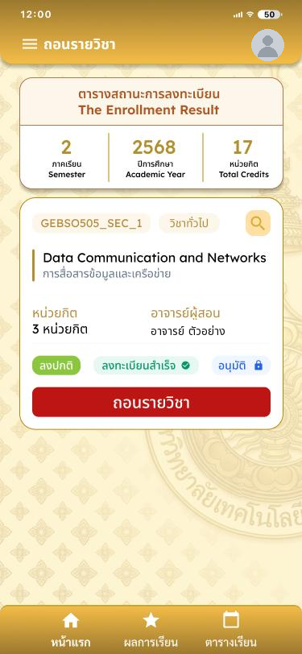 | 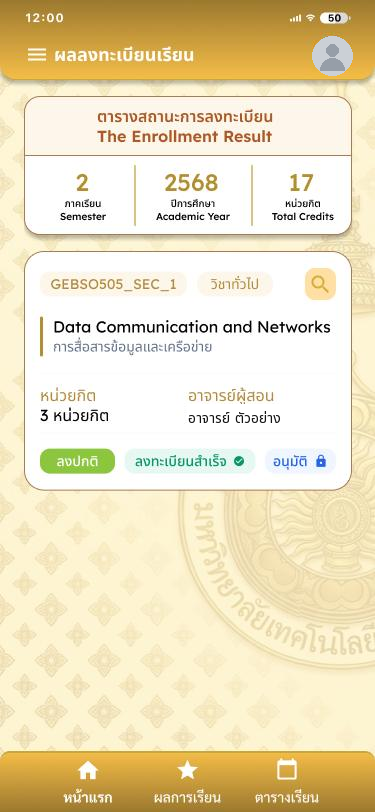 | 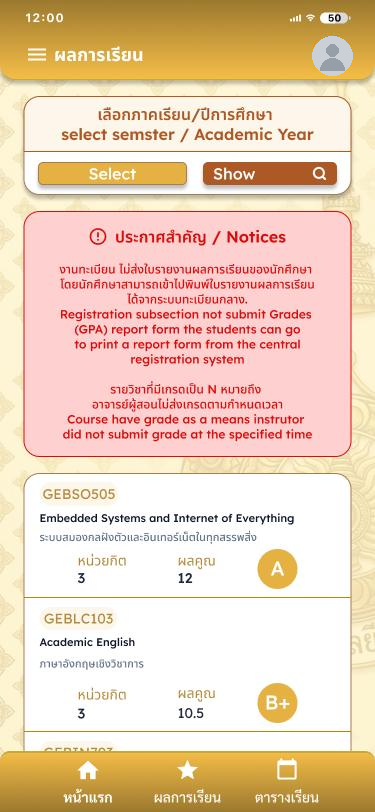 |
| การ์ดวิชา + ปุ่ม **ถอนรายวิชา** (สีแดง) และ modal "ยืนยันการถอนรายวิชา" | สรุปภาค/ปี/หน่วยกิต, การ์ดวิชาพร้อม badge: ลงปกติ · ลงทะเบียนสำเร็จ ✓ · อนุมัติ 🔒 | เลือกภาค/ปี + Show, กล่อง Notices (สีแดงอ่อน), การ์ดวิชาพร้อมหน่วยกิต ผลคะแนน และเกรดแบบวงกลม |

### SCR-09 / SCR-10

| ยื่นขอสำเร็จการศึกษา | สถานะการชำระเงิน |
|---|---|
| 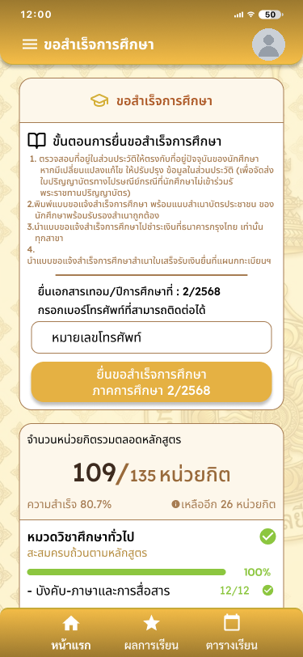 | 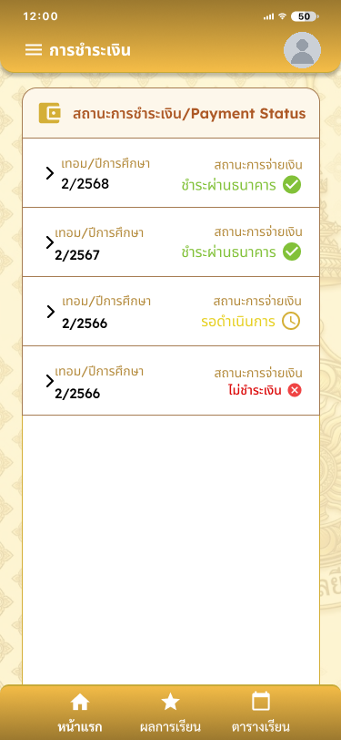 |
| ขั้นตอนการยื่น, ช่องเบอร์โทร, ปุ่มยื่น (disabled ถ้าไม่ครบเงื่อนไข), หน่วยกิตสะสม 109/135 (80.7%), progress แยกหมวดวิชา | รายการเทอม/ปี พร้อมสถานะ: ✅ ชำระผ่านธนาคาร / ⏳ รอดำเนินการ / ❌ ไม่ชำระเงิน กดขยายเพื่อดูรายละเอียดและพิมพ์ใบเสร็จ |

## Happy Path flows (ทดสอบแล้ว)

ภาพลำดับหน้าจออยู่ใน [`design/flows/`](../design/flows)

1. **ค้นหาและลงทะเบียนเรียน:** Home → Menu → ลงทะเบียนเรียน → เงื่อนไข (ยืนยัน) → ค้นหา → เลือก → ลงแบบปกติ/เสรี → ยืนยัน → ลงทะเบียนสำเร็จ
2. **ถอนรายวิชา:** Home → Menu → ถอนรายวิชา → กดถอนรายวิชา → ยืนยัน → สถานะการถอน
3. **ดูผลการลงทะเบียน:** Home → ปุ่ม "ผลลงทะเบียน" (หรือ Menu) → หน้าผลลงทะเบียนเรียน

## Wireframes

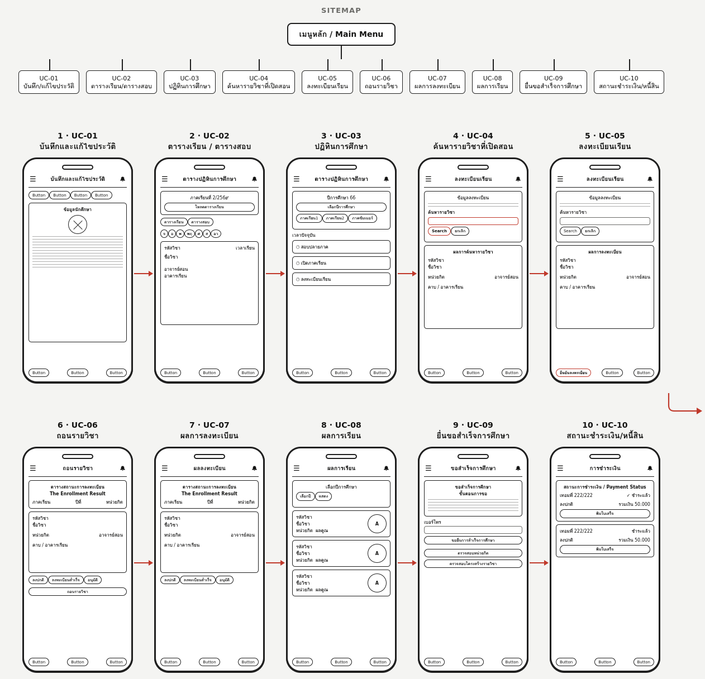

## Prototype state logic (Figma Variables)

ไฟล์ Figma ใช้ **Boolean Variables** ควบคุมพฤติกรรมของ Prototype ไฟล์ export ดิบอยู่ที่ [`design/figma/prototype-variables.json`](../design/figma/prototype-variables.json) ฝั่งแอปให้ทำเป็น form state ดังนี้

| Collection | Variable | ค่าเริ่มต้น | ความหมาย / พฤติกรรมที่ต้องทำในแอป |
|---|---|---|---|
| Login Prototype | `accountFilled` | `false` | กรอก RMUTL Account แล้ว |
| Login Prototype | `passwordFilled` | `false` | กรอกรหัสผ่านแล้ว |
| Login Prototype | `loginLocked` | `true` | ปุ่ม "เข้าสู่ระบบ" ถูกล็อก (disabled) จนกว่า `accountFilled && passwordFilled` |
| Login Prototype | `loginError` | `false` | แสดงสถานะ Error ของฟอร์ม Login (เช่น รหัสผ่านไม่ถูกต้อง) |
| Collection | `Email complete` | `false` | ช่องอีเมลกรอกครบ/ถูกรูปแบบ (ฟอร์มแก้ไขประวัติ) |
| Collection | `Colour complete` | `false` | state ที่ใช้เปลี่ยนสีองค์ประกอบเมื่อกรอกครบ |
| Collection | `Form error` | `false` | แสดง Error state ของฟอร์ม (กรอบแดงใน Input แบบ Wrapped) |

```ts
// ตัวอย่าง logic หน้า Login ตาม Prototype
const loginLocked = !(accountFilled && passwordFilled);
```

> ความหมายของ `Email complete` / `Colour complete` ตีความจากชื่อตัวแปร ควรยืนยันกับทีมออกแบบ
