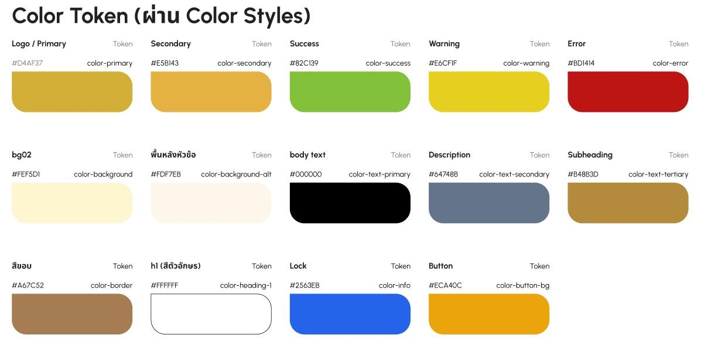
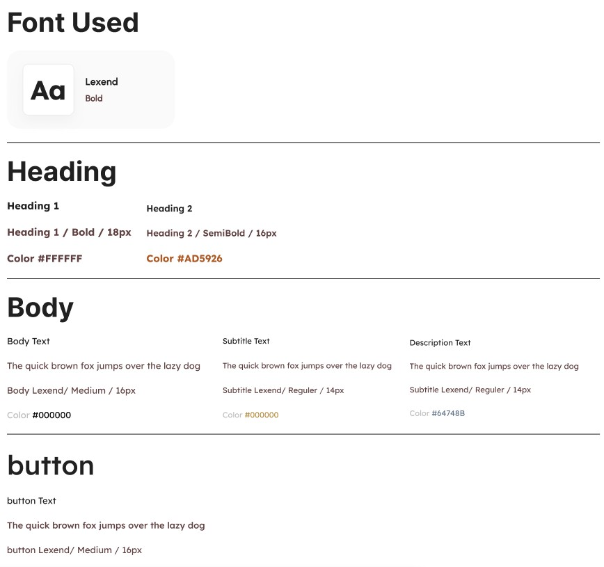
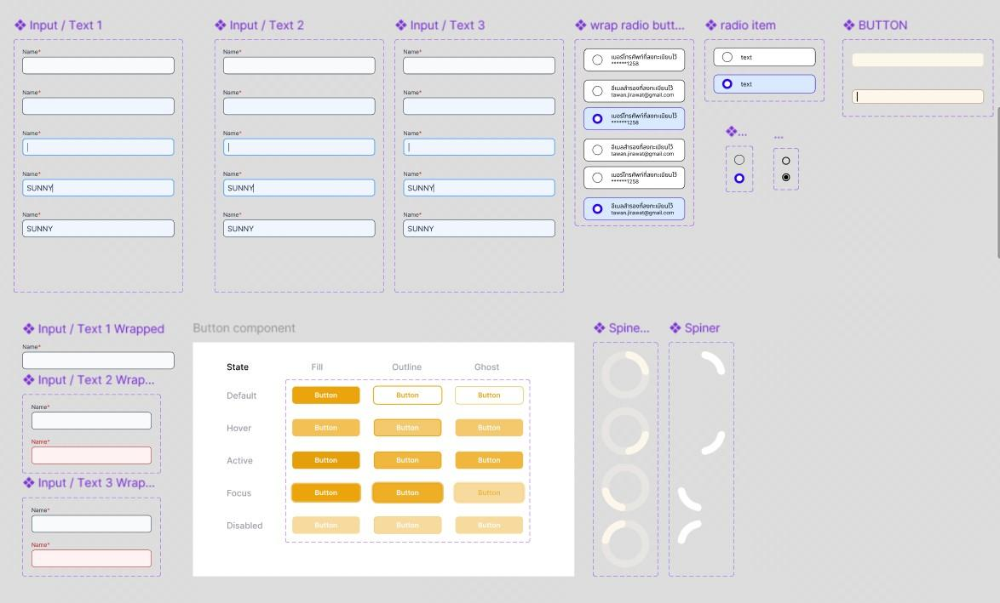
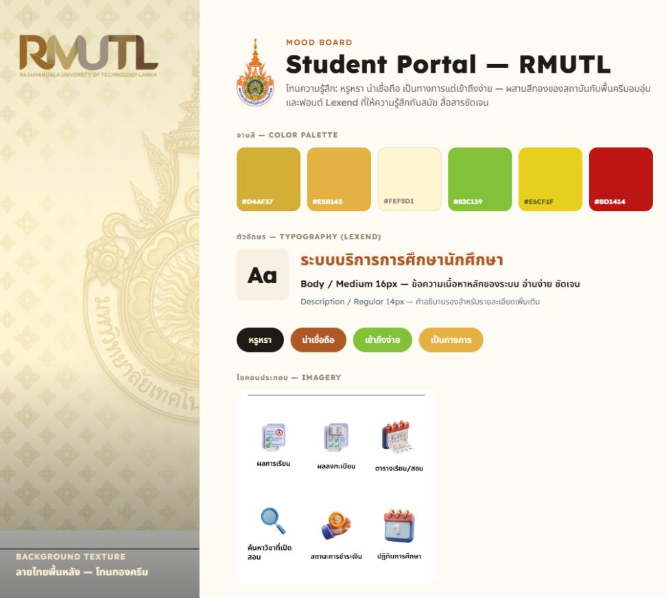

# 07 — Design System

**แหล่งค่าหลัก (Source of truth):** Figma **Styles** (Color, Text, Gradient, Grid) export ด้วยปลั๊กอิน *Design Tokens*
- ไฟล์ export ดิบ: [`design/figma/figma-styles-export.tokens.json`](../design/figma/figma-styles-export.tokens.json)
- ไฟล์สำหรับ Developer: [`design/tokens/tokens.json`](../design/tokens/tokens.json) (W3C DTCG) และ [`design/tokens/tokens.css`](../design/tokens/tokens.css)

ชื่อ token ฝั่งโค้ดเป็นภาษาอังกฤษแบบ semantic ส่วนคอลัมน์ "Figma Style" คือชื่อจริงใน Figma ใช้ค้นใน Dev Mode
ถ้าแก้ค่าใน Figma ให้ export ใหม่ แล้วอัปเดต `tokens.json` ตาม

## Colors

| CSS variable | Figma Style | ค่า | ใช้กับ |
|---|---|---|---|
| `--color-brand-primary` | primary | `#D4AF37` | สีหลัก: โลโก้, แถบเมนู, ปุ่มหลัก |
| `--color-brand-primary-dark` | primary/dark | `#B48F2F` | ทองเข้ม สำหรับพื้นปุ่ม/แถบเน้น |
| `--color-brand-secondary` | secondary | `#E5B143` | สีรอง: องค์ประกอบย่อย, ไอคอนการ์ด |
| `--color-brand-accent` | 'logo select | `#AD5926` | สถานะเลือก (selected) ของเมนู/โลโก้ |
| `--color-brand-logo` | logo | `#D4AF37` | สีโลโก้ (เท่ากับ primary) |
| `--color-button-default` | button | `#ECA40C` | พื้นปุ่มหลัก |
| `--color-button-pressed` | button on click | `#B05D0BE6` | พื้นปุ่มตอนกด (opacity 90%) |
| `--color-background-default` | bg02 | `#FEF5D1` | พื้นหลังหน้าจอหลัก |
| `--color-background-subtle` | พื้นหลังหัวข้อ | `#FDF7EB` | พื้นหลังหัวข้อ/หัวการ์ด |
| `--color-surface-white` | surface/white | `#FFFFFF` | พื้นการ์ด, กล่องข้อมูล, ช่องกรอก |
| `--color-surface-highlight` | surface/highlight | `#FFE3AE` | พื้นไฮไลต์เหลืองอ่อน: แถวที่เลือก, ป้ายแจ้งเตือน |
| `--color-text-primary` | body text | `#000000` | ข้อความเนื้อหา |
| `--color-text-heading` | h2 | `#AD5926` | สีหัวข้อ h2 (บนพื้นสว่าง) |
| `--color-text-heading-home` | h2 หน้าแรก | `#000000` | หัวข้อ h2 ในหน้าแรก |
| `--color-text-on-primary` | h1 | `#FFFFFF` | ข้อความ h1 บนแถบสีทอง (ขาว) |
| `--color-text-subheading` | subheading | `#B48B3D` | หัวข้อรอง / label |
| `--color-text-secondary` | description | `#64748B` | คำอธิบาย |
| `--color-text-disabled` | text/disabled | `#94A3B8` | placeholder, ข้อความที่ใช้งานไม่ได้ |
| `--color-border-default` | สีขอบ | `#A67C52` | เส้นขอบหลัก |
| `--color-border-gold` | สีขอบทอง | `#C6AA38` | เส้นขอบทอง: Input, Card, Button, Table |
| `--color-border-light` | สีขอบอ่อน | `#F3ECDE` | เส้นแบ่ง/ขอบสีอ่อน |
| `--color-neutral-light` | neutral/light | `#F1F1F1` | พื้นเทาอ่อน, เส้นแบ่ง |
| `--color-neutral-disabled` | neutral/disabled | `#D1D1D1` | พื้นปุ่ม/ช่องที่ใช้งานไม่ได้ |
| `--color-neutral-muted` | neutral/muted | `#A8A8A8` | ไอคอน/องค์ประกอบสีเทา |
| `--color-status-success` | success | `#82C139` | สำเร็จ |
| `--color-status-warning` | warning | `#E6CF1F` | แจ้งเตือน |
| `--color-status-danger` | error | `#BD1414` | ข้อผิดพลาด, ปุ่มถอนรายวิชา |
| `--color-status-danger-light` | error/light | `#FFD0D0` | พื้นหลังแจ้งข้อผิดพลาด (เช่นกล่อง Notices) |
| `--color-status-locked` | lock | `#2563EB` | ไอคอน/ป้าย "อนุมัติ 🔒" |

> ✅ **Primary = `#D4AF37`** ยืนยันจาก Figma Styles แล้ว ค่า `#D96B00` ที่เล่มอ้างถึงไม่มีอยู่ในไฟล์ Figma ให้ถือว่าเป็นค่าเก่า
> สีปุ่มหลักใน Figma คือ `button #ECA40C` (ตอนกด `#B05D0B` opacity 90%) ไม่ใช่ primary ตรงๆ และแถบหัวหน้าจอใช้ gradient

## Gradients

| CSS variable | Figma Style | ค่า |
|---|---|---|
| `--gradient-header` | header gradient | `linear-gradient(137.11deg, #9C792F 0%, #F6BE48 100%)` |
| `--gradient-button` | gold gradient/button | `linear-gradient(316.47deg, #9C792F 0%, #F6BE48 100%)` |

ไล่จาก `#9C792F` (ทองเข้ม) ไป `#F6BE48` (ทองสว่าง) มุมอ้างอิงตามค่า rotation ใน Figma ควรเทียบกับภาพหน้าจออีกครั้งตอน implement

## Typography

ฟอนต์ **Lexend** ทุก style, letter-spacing 0

| CSS variable | Figma Style | Size | Weight | Line height | ใช้กับ |
|---|---|---|---|---|---|
| `--text-h1` | h1 | 18px | 700 | 21.6px |  |
| `--text-h2` | h2 | 16px | 600 | 19.2px |  |
| `--text-h3` | h3 | 14px | 500 | 20px | เนื้อหา |
| `--text-body-text` | body-text | 16px | 400 | 20px |  |
| `--text-subheading` | subheading | 14px | 400 | 20px |  |
| `--text-description` | description | 14px | 400 | 16.8px |  |
| `--text-button` | ปุ่ม | 16px | 500 | 19.2px |  |
| `--text-body-medium` | body-medium | 16px | 500 | 19.2px | เนื้อหาที่ต้องการเน้น (ตาม Body ในเอกสาร DS) |
| `--text-display-20` | display/20 | 20px | 500 | 24px | หัวข้อบนแถบสีทอง, ข้อความเด่นในการ์ด |
| `--text-display-24` | display/24 | 24px | 600 | 28.8px | หัวข้อใหญ่ เช่น ตัวเลขสรุป, หัวข้อหน้าพิเศษ |
| `--text-title-16-bold` | title/16 bold | 16px | 700 | 19.2px | หัวข้อการ์ด/หัวตาราง แบบหนา |
| `--text-label-14-semibold` | label/14 semibold | 14px | 600 | 16.8px | ป้ายกำกับ, หัวคอลัมน์ |
| `--text-label-13-semibold` | label/13 semibold | 13px | 600 | 15.6px | ป้ายกำกับขนาดเล็ก |
| `--text-caption-12-medium` | caption/12 medium | 12px | 500 | 14.4px | คำอธิบายสั้น, แท็ก, ป้ายสถานะ |
| `--text-caption-12-regular` | caption/12 regular | 12px | 400 | 14.4px | ข้อความช่วยเหลือ, ข้อความแจ้งข้อผิดพลาดใต้ช่องกรอก |
| `--text-small-11-medium` | small/11 medium | 11px | 500 | 13.2px | ข้อมูลรองในตาราง |
| `--text-small-11-regular` | small/11 regular | 11px | 400 | 13.2px | ข้อมูลรองในตาราง แบบปกติ |
| `--text-tiny-10-medium` | tiny/10 medium | 10px | 500 | 12px | ป้ายใต้ไอคอน, วันที่ในปฏิทิน |
| `--text-tiny-10-bold` | tiny/10 bold | 10px | 700 | 12px | ตัวเลข/ป้ายเล็กแบบหนา |

> ⚠️ **Lexend ไม่มี glyph ภาษาไทย** ข้อความไทยจะใช้ฟอนต์ fallback ของระบบ ใน `tokens.css` จึงกำหนด `Noto Sans Thai` เป็น fallback ไว้ ให้ทีมออกแบบยืนยันว่าจะใช้ฟอนต์ไทยตัวใด

## Layout Grid

| Grid | Columns | Column width | Gutter | Alignment |
|---|---|---|---|---|
| main | 4 | 70px | 16px | center |
| popup | 4 | 70px | 5px | center |

Frame 375 × 812 px

## Spacing & Shape

- **8-pt grid:** ระยะห่างเป็นผลคูณของ 8 (`--space-1` = 8px … `--space-6` = 48px) มาจากเอกสาร DS ไม่ได้อยู่ใน Figma Styles
- **Border radius ปุ่ม:** 8px (จากเอกสาร DS)
- **Icons:** ลายเส้น Outline

## Components & States

| Component | Variants | States | Token ที่เกี่ยวข้อง |
|---|---|---|---|
| Button | Fill, Outline, Ghost | Default, Hover, Active, Focus, Disabled | `button-default`, `button-pressed`, `neutral-disabled`, `gradient-button` |
| Form Input | Default, Wrapped | Default, Focus, Filled, Error (กรอบแดง) | `surface-white`, `border-gold`, `status-danger`, `text-disabled` (placeholder), `--text-caption-12-regular` (ข้อความ error) |
| Radio Button | เดี่ยว, มีกรอบ | Selected, Unselected | `brand-accent` |
| Card (List Item) | — | Selected, Unselected | `surface-white`, `surface-highlight`, `border-light` |
| Spinner (Loading) | Ring, Arc | — | `brand-primary` |
| Status Badge | ลงปกติ, ลงทะเบียนสำเร็จ, อนุมัติ 🔒, ชำระผ่านธนาคาร, รอดำเนินการ, ไม่ชำระเงิน | — | `status-*`, `--text-caption-12-medium` |
| Segmented / Tab | ตารางเรียน-ตารางสอบ, ภาค 1-2-ฤดูร้อน, ลงแบบปกติ-เสรี | Active, Inactive | `brand-primary`, `brand-primary-dark` |
| Modal / Dialog | เงื่อนไขการลงทะเบียน, ยืนยันการถอนรายวิชา | — | `surface-white`, `status-danger` |
| Notice box | ประกาศสำคัญ (หน้าผลการเรียน) | — | `status-danger-light`, `status-danger` |
| App bar | — | — | `gradient-header`, `text-on-primary`, `--text-h1` |

ทุก Component ใน Figma จัดการผ่าน **Variant Properties** ฝั่งโค้ดควรสร้างเป็น reusable component ให้ตรงกัน (คอลัมน์ token เป็นการ map ตามชื่อและคำอธิบายของ Style ควรเช็กกับ Figma Dev Mode)

## Mood Board

โทนทองตามอัตลักษณ์มหาวิทยาลัย พื้นหลังลายไทยจางๆ ให้ความรู้สึกเป็นทางการแต่อ่านง่าย
